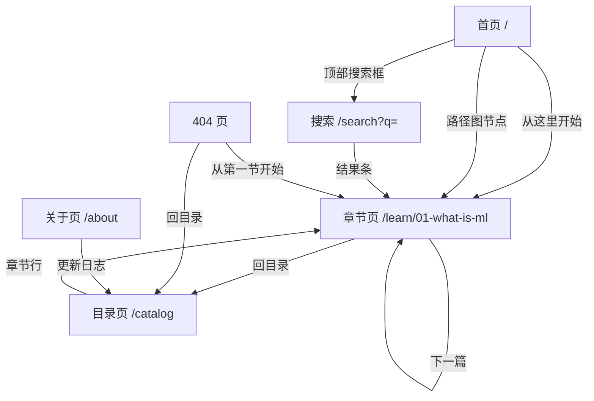

# 机器学习讲解网站 PRD

## 0. 文档元信息

- 文档状态：草稿（等你过一遍即可升为交付版）
- 版本：v0.1
- 最后更新：2026-10-09
- 产品名称：机器学习讲解网站
- 负责人：你自己（内容与决策）
- 目标读者：你自己 / AI 编码助手 / 前端开发 / 内容审校
- 文档边界：这是 PRD，不是开发任务文档；但要具体到 AI 或开发能照着实现

---

## 1. 产品结论

这一版要做的是一个「讲人话」的机器学习入门站：不吓人、不堆公式，用图解和生活化的例子把最基本的概念讲透，让完全没学过编程和数学的人也能用自己的话讲清机器学习在干什么。它**不是**课程平台、**不是**代码练习站、**不是**就业培训，本期也不做任何需要后端的功能。

### 1.1 核心定位（一句锁死）

```text
一个面向零基础者的机器学习入门站：先用图解和生活化例子把基本概念讲透，
让读者能用自己的话讲清机器学习在干什么；本期只交付这一段，
"能自己跑通一个小项目"是这条路径的下一段，放到以后再说。
```

### 1.2 明确不做 / 不是什么

- 本期不做可运行代码示例与 Notebook（不涉及任何让读者装环境、跑代码的内容）
- 本期不做章节测验与答案解析
- 本期不做端到端实战项目
- 本期不做用户账号、评论、云端进度同步等任何需要后端的功能（浏览器本地的已读标记除外）
- 不做英文版与多语言
- 不做付费课程、证书与就业推荐
- 不做需要实时计算或 AI 接口的功能（本期零 API 成本）

### 1.3 核心目标与成功标志

| 目标 | 说明 | 成功标志（可验证） |
|------|------|------------------|
| 让零基础读者建立「机器学习是什么」的直觉 | 首页直达第一节，不迷路 | 从打开首页到读完第一节，路径不超过 2 次点击；第一节末尾的「本节要点」能答出"训练和预测的区别" |
| 让读者随时找得回想复看的概念 | 目录 + 站内搜索 | 在搜索框输入任一名词，1 秒内出结果，点结果能跳到对应段落 |
| 内容能长期低成本维护 | Markdown 写稿 + 静态托管 | 「改一段文字 → 站点更新」15 分钟内独立走完一次 |
| 手机端也能顺畅读完一节 | 响应式排版 | 手机打开任一章节，正文无横向溢出、字号不小于 16px |
| 零成本长期运行 | 纯静态、无后端 | 每月固定支出为 0 元 |

---

## 2. 用户、场景与形态

### 2.1 目标用户

| 用户类型 | 关注点 | 产品要回答的问题 |
|---------|-------|----------------|
| 零基础转行者（主要服务对象） | 术语太多、不知道从哪下手、怕数学 | 机器学习到底在干什么？监督和无监督差在哪？我该先看哪一节？ |
| 被术语劝退的职场人 / 在校学生（顺带服务） | 只想搞懂概念，暂时不想写代码 | 这些名词对应的人话是什么？什么场景该用哪种方法？ |
| 需要向别人解释 ML 的岗位（顺带服务） | 要能直接拿去讲 | 有没有现成的、能复述的例子和说法？ |

> 界面语言全部用大白话，专业名词第一次出现时必须紧跟一句白话解释。

### 2.2 关键用户任务

1. 打开首页 → 看懂这是什么 → 点「从这里开始」进入第一节
2. 按学习路径一节接一节读下去，每节末尾点「下一篇」，不迷路
3. 边看示意图边理解，读完能用自己的话复述「训练和预测的区别」
4. 想复看某个概念 → 用搜索或目录直接跳回对应段落
5. 发现内容写错或看不懂 → 通过页脚纠错入口反馈

### 2.3 形态与资源约束（最关键，别省）

| 项 | 决定 |
|----|------|
| 它活在哪 | 纯前端网页（无后端、无服务器），部署在免费静态托管上 |
| 已有可复用资源 | 只有自己的电脑，无常开服务器；无 AI 接口 key、无自有域名；可用 GitHub Pages / Vercel 免费托管 |
| 数据存哪、留不留得住 | 不收集任何用户个人信息；无账号、无评论；已读标记只存在浏览器本地，清缓存即丢失，站点不做提示也不做恢复 |
| 谁来长期维护 | 本人：不会写代码，靠 AI 生成内容与代码，自己负责内容审核与文字修改 |
| 预算与按量成本 | 零预算，只用免费额度；不接任何按量计费的接口，每月固定支出为 0 |

> 形态理由：资源清单里没有常开服务器、也不想买后端；教学内容以图文为主，纯前端静态站扔免费托管最省心，零月费、零运维。

---

## 3. 信息架构

### 3.1 导航 / 入口

| 入口 | 路由 | 说明 |
|------|------|------|
| 顶部导航「首页」 | `/` | 回首页学习路径图 |
| 顶部导航「目录」 | `/catalog` | 全部章节列表 |
| 顶部导航「关于」 | `/about` | 这站是什么、内容来源、更新日志、纠错方式 |
| 顶部搜索框（各页常驻） | `/search?q=关键词` | 全站按标题和正文检索 |
| 首页主按钮「从这里开始」 | `/learn/01-what-is-ml` | 进入第一节 |
| 首页学习路径图节点 | `/learn/{slug}` | 每个节点进入对应章节 |
| 目录页章节行 | `/learn/{slug}` | 进入对应章节 |
| 搜索结果条 | `/learn/{slug}#段落锚点` | 跳到该章节对应段落 |
| 章节页底部「下一篇」 | 下一节路由 | 读到最后一节时指向「下一步学什么」说明段 |
| 章节页底部「回目录」 | `/catalog` | 回目录页 |
| 404 页「回目录」 | `/catalog` | 兜底出口 |
| 404 页「从第一节开始」 | `/learn/01-what-is-ml` | 兜底出口 |
| 页脚「纠错」 | 邮件链接 | 打开邮件草稿，正文自动带上当前页标题与链接 |

### 3.2 路由兜底规则

| 输入 | 处理 |
|------|------|
| 根路径 `/` | 显示首页 |
| 未知路由（打错字、已删除的旧链接） | 显示 404 页，含「回目录」「从第一节开始」两个入口，并返回 404 状态码 |
| 章节旧链接（如 `/chapters/old-slug`） | 重定向到当前对应章节 |
| 路由带多余尾斜杠 | 归一化后按正常路由处理 |
| 尚未写完的章节被直接访问 | 不生成任何入口链接；直接访问时显示「本节正在整理中」并给回目录入口 |

### 3.3 页面结构总览



---

## 4. 页面 / 功能规格

### 4.1 内容大纲（MVP 交付的 10 节）

| 序号 | 分组 | 标题 | 讲什么 | 配图要求 |
|------|------|------|--------|---------|
| 1 | 入门 | 什么是机器学习 | 用「西瓜甜不甜」讲：从数据里找规律，而不是人把规则写死 | 传统编程（人写规则）与机器学习（数据长出规则）流程对比图 |
| 2 | 入门 | 训练与预测：模型在干什么 | 训练像刷题、预测像考试，两者不是一回事 | 数据 → 训练 → 模型 → 预测 流程图 |
| 3 | 入门 | 关于机器学习的三个常见误解 | 它不是魔法、不一定比人准、数据不好它也白搭 | 「垃圾进，垃圾出」示意图 |
| 4 | 概念 | 监督学习：有标准答案的学习 | 拿带标签的数据，学「输入 → 答案」的对应关系 | 带答案的练习册示意图 |
| 5 | 概念 | 无监督学习：没有答案时怎么找结构 | 没人告诉答案时，按相似程度自动分成一堆堆 | 混在一起的豆子按大小分堆示意图 |
| 6 | 概念 | 分类与回归：一个猜种类，一个猜数字 | 两种最常见任务的差别，用买菜和房价举例 | 左：给水果贴「苹果/梨」标签；右：房价随面积变化的散点图 |
| 7 | 概念 | 特征与标签 | 用「选房子」讲：面积、楼层是特征，成交价是标签 | 一张表格，用颜色标出哪些列是特征、哪列是标签 |
| 8 | 算法 | 过拟合：为什么「背题」考不好 | 只会做原题就等于没学会，要的是举一反三 | 一条弯弯曲曲贴合每个点的线 vs 一条平滑的线 |
| 9 | 算法 | 聚类与推荐：它怎么知道你可能喜欢 | 用推荐歌单讲相似度：像的东西放一起 | 几张歌单之间用相似度连线 |
| 10 | 算法 | 怎么判断一个模型好不好 | 用考试成绩讲准确率的陷阱：99% 也可能一个都没抓出来 | 同一批样本下「高准确率但漏掉全部异常」的对照图 |

- 每节正文 800–1500 字，预计阅读 8–12 分钟，节与节之间不假设读者记得上一节的细节。
- 每节末尾固定给 3–5 条「本节要点」，用大白话写，可直接被人复述。
- 顺序即学习路径，按序号读下来即可，不需要读者自己做选择。

### 4.2 首页 `/`

页面目标：3 秒内让读者明白「这是什么」和「从哪开始」。

| 元素 | 内容要求 | 点击 / 行为结果 |
|------|---------|---------------|
| 主标题 + 一句话说明 | 说清「给零基础的人讲机器学习，不用装任何东西」 | 无 |
| 主按钮「从这里开始」 | 文案固定，按钮在全站视觉上最显眼 | 进入 `/learn/01-what-is-ml` |
| 学习路径图 | 10 个节点按「入门 / 概念 / 算法」三组排列，每个节点显示序号、标题、预计阅读时长、难度（入门 / 进阶） | 点任一节点进入该章节 |
| 三行使用说明 | ①不用装任何东西 ②建议按顺序看 ③想到什么词可以直接搜 | 第三行点进 `/about` |
| 顶部搜索框 | 占位文案「搜概念，比如"监督学习"」 | 进入 `/search?q=关键词` |
| 页脚 | 关于、纠错邮件链接、最后更新日期 | 进 `/about` 或打开邮件草稿 |

### 4.3 章节页 `/learn/{slug}`

页面目标：一次只讲清一个概念，读完能复述。

| 元素 | 内容要求 | 点击 / 行为结果 |
|------|---------|---------------|
| 页首信息 | 序号 + 标题 + 所属分组 + 预计阅读时长 | 无 |
| 正文区 | Markdown 渲染；行宽控制在一行约 36 个汉字，段落短，每段不超过 5 行 | 无 |
| 示意图 | 至少 1 张；图下必须有一句图注，说明这张图在讲什么 | 点击图片可放大查看 |
| 本节要点 | 3–5 条大白话要点，位于正文末尾 | 无 |
| 「下一篇」按钮 | 固定在正文末尾，显示下一节标题 | 进入下一节；最后一节改为「下一步学什么」说明 |
| 「回目录」链接 | 与「下一篇」并排 | 进入 `/catalog` |
| 最后更新日期 | 形如「最后更新：2026-10-09」 | 无 |
| 页脚纠错入口 | 文案「这节有错？告诉我们」 | 打开邮件草稿，正文自动带本节标题与链接 |

### 4.4 目录页 `/catalog`

页面目标：一屏看清全站有什么，并能直接跳过去。

| 元素 | 内容要求 | 点击 / 行为结果 |
|------|---------|---------------|
| 三个分组标题 | 入门 / 概念 / 算法，各带一句分组说明 | 无 |
| 章节行 | 序号 + 标题 + 一句话说明 + 预计阅读时长 + 已读标记 | 进入该章节 |
| 进度条 | 形如「已读 3 / 10」，数据取自浏览器本地记录 | 无 |
| 顶部搜索框 | 与其他页一致 | 进入 `/search?q=关键词` |

### 4.5 搜索结果页 `/search?q=关键词`

页面目标：让读者 3 秒内跳到想看的那一段。

| 元素 | 内容要求 | 点击 / 行为结果 |
|------|---------|---------------|
| 结果条 | 章节标题 + 命中片段（关键词高亮）+ 所属分组 | 跳到 `/learn/{slug}#段落锚点`，并高亮该关键词 |
| 结果排序 | 标题命中排在正文命中之前 | 无 |
| 无结果状态 | 显示「没有找到"XX"」，并给 3 个推荐章节入口 | 点推荐章节进入对应页 |
| 关键词为空 | 不发起检索，直接显示推荐章节 | 同上 |

### 4.6 404 页

| 元素 | 内容要求 | 点击 / 行为结果 |
|------|---------|---------------|
| 提示文案 | 「没找到这个页面，可能是链接写错了」 | 无 |
| 按钮「回目录」 | 主按钮样式 | 进入 `/catalog` |
| 按钮「从第一节开始」 | 次按钮样式 | 进入 `/learn/01-what-is-ml` |

### 4.7 关于页 `/about`

| 元素 | 内容要求 | 点击 / 行为结果 |
|------|---------|---------------|
| 这站是什么 / 不是什么 | 与 1.1、1.2 的定位和边界口径一致 | 无 |
| 内容怎么来的 | 说明由 AI 生成初稿 + 人工审核，并列参考资料 | 参考资料可点击跳转来源 |
| 更新日志 | 按日期倒序列出各章节的更新时间与改动要点 | 点章节名进入该章节 |
| 纠错方式 | 说明邮件反馈的格式与预期响应时间 | 打开邮件草稿 |

---

## 5. 链路闭合（无死胡同）

| 入口 | 点击后 |
|------|-------|
| 顶部导航「首页」 | 回到 `/` 首页学习路径图 |
| 顶部导航「目录」 | 进入 `/catalog` |
| 顶部导航「关于」 | 进入 `/about` |
| 顶部搜索框 | 进入 `/search?q=关键词`，关键词为空时显示推荐章节 |
| 首页主按钮「从这里开始」 | 进入 `/learn/01-what-is-ml` |
| 首页路径图节点 | 进入对应章节页 |
| 目录页章节行 | 进入对应章节页 |
| 搜索结果条 | 跳到对应章节的对应段落并高亮关键词 |
| 章节页「下一篇」 | 进入下一节；最后一节指向「下一步学什么」说明段 |
| 章节页「回目录」 | 进入 `/catalog` |
| 章节页示意图 | 放大查看，再次点击关闭 |
| 页脚「纠错」 | 打开邮件草稿，正文自动带当前页标题与链接 |
| 页脚「关于」 | 进入 `/about` |
| 404 页两个按钮 | 分别去 `/catalog` 和 `/learn/01-what-is-ml` |

> 自查结论：全站不存在"点了没反应"的元素；每个页面的出口都至少有一条能回到目录或首页。

---

## 6. 状态与反馈规则

| 状态 / 操作 | 规则 |
|-----------|------|
| 读完一节 | 浏览器本地记录该节为已读；路径图与目录页显示已读标记 |
| 换设备或清缓存 | 已读记录丢失，回到全部未读；站点不提示、不尝试恢复 |
| 搜索有结果 | 结果按「标题命中优先」排序，关键词在片段中高亮 |
| 搜索无结果 | 显示「没有找到"XX"」+ 3 个推荐章节入口，不显示空白区域 |
| 搜索关键词为空 | 不发起检索，直接显示推荐章节 |
| 图片加载失败 | 显示占位文字，说明这张图原本在讲什么，不留空白 |
| 图片体积 | 单张正文图压缩到 200KB 以内，避免首屏长时间空白 |
| 一节正文较长（超过 12 分钟阅读量） | 页面右侧（手机端为顶部折叠区）显示本节目录锚点，并标出当前位置 |
| 内容有改动 | 更新该页顶部的「最后更新」日期，并在 `/about` 的更新日志加一行 |
| 章节尚未写完 | 不生成任何入口链接；直接访问显示「本节正在整理中」并给回目录入口 |
| 表单类输入 | 全站无表单提交，仅有搜索框；搜索框只做去空格与长度截断，不做登录与校验流程 |

---

## 7. 边界情况与容错

| 情况 | 希望它怎么办 |
|------|------------|
| 内容写错：术语解释不准或例子有误导性 | 每篇文章发布前人工审核一遍；页面底部标「最后更新日期」，并提供纠错入口 |
| 手机上看公式、表格、示意图排版乱 | 响应式布局 + 移动端字号行宽适配；公式与宽表格允许横向滚动，不挤压变形 |
| 图片过大导致加载慢，或图挂了只剩空白 | 图片本地存放并压缩到 200KB 以内；加载失败时显示占位文字说明该图在讲什么 |
| 用户访问到不存在的链接（打错字或旧链接） | 提供 404 页，给「回目录」和「从第一节开始」入口，不留死胡同 |
| 章节越加越多，用户在目录里找不到想看的概念 | 目录页按「入门 / 概念 / 算法」分组，并提供站内搜索 |
| 读者看完最后一节不知道下一步学什么 | 最后一节末尾给「下一步学什么」说明，并回到学习路径图入口 |
| 内容被别的网站抓走或改写 | 静态站无法完全阻止；页面标注来源与更新日期，至少让读者能核对原始出处 |

---

## 8. 内容与合规

### 8.1 必须表达

- 必须讲清这是零基础入门科普与知识梳理，不替代系统课程与系统训练。
- 引用他人观点、案例、图片时注明来源。
- 每页标注最后更新日期。
- 关于页必须写清内容的生产方式（AI 生成初稿 + 人工审核）。

### 8.2 禁止表达

- 不承诺「学完就能转行成功」「包就业」「涨薪」。
- 不使用未授权的付费课程内容、数据集与图片。
- 页面上不出现任何密钥、账号或内部实现细节。
- 不使用「最权威」「业内第一」这类无法核实的表述。

---

## 9. 验收标准

| 编号 | 验收项 | 通过标准 |
|------|-------|---------|
| A1 | 当我用浏览器打开首页时，则在 2 秒内看到学习路径图和「从这里开始」按钮，全程不需要登录或安装任何东西。 | 手动打开首页，计时并确认两个元素均在首屏；控制台无报错 |
| A2 | 当我在手机上打开任意章节页时，则正文左右无溢出（公式和宽表格可横向滚动），正文字号不小于 16px。 | 手机实测全部 10 节，逐节确认无横向滚动条、字号达标 |
| A3 | 当我在搜索框输入「监督学习」时，则 1 秒内出现结果列表，点任一条能跳到对应章节的对应段落。 | 手动搜索该词，确认出结果、跳转位置正确且关键词高亮 |
| A4 | 当我访问一个不存在的地址时，则看到 404 页，页面上有「回目录」和「从第一节开始」两个可点入口，不出现空白页或死链。 | 手动访问一个随机地址，确认页面元素与 404 状态码 |
| A5 | 当我在目录页点击任一章节标题时，则该章节页正常显示正文、至少 1 张示意图、图注和最后更新日期。 | 逐节点开 10 节，确认四项内容齐全 |
| A6 | 当我读完任意一节时，则本节末尾有「下一篇」入口；读到第 10 节时，末尾给出下一步学习方向而不是断头路。 | 逐节确认末尾入口存在，且第 10 节给的是下一步说明 |
| A7 | 当我把任意章节的链接复制给别人时，对方无需登录即可打开同一节内容，且能看到该页最后更新日期。 | 换一台设备或不登录状态打开链接验证 |
| A8 | 当我按目录顺序读完全部 10 节时，则每节的「本节要点」都有 3–5 条，且不存在空章节或占位内容。 | 逐节清点要点条数，确认无「待整理」类内容 |
| A9 | 当我搜索一个站里不存在的词时，则看到「没有找到」提示和至少 3 个推荐章节入口。 | 手动搜索随机乱码字符串验证 |

---

## 10. MVP 完成定义

1. 入门 3 节 + 概念 4 节 + 算法 3 节，共 10 篇正文全部可访问，每篇有经人工审核的正文、至少 1 张带图注的示意图、3–5 条本节要点、最后更新日期。
2. 首页学习路径图可点进每一节，节点显示序号、标题、预计阅读时长与难度。
3. 目录页按「入门 / 概念 / 算法」分组列全 10 节，无缺项，并能显示已读进度。
4. 站内搜索能按标题和正文关键词检索、能跳转并高亮。
5. 404 页、关于页可用，页脚有纠错入口。
6. 手机与桌面浏览器各走一遍全站，无横向溢出、无死链、无空白页。
7. 站点部署在免费静态托管上，「改文字 → 重新上线」的流程能在 15 分钟内独立走完一次。

---

## 11. 以后再说（可扩展项）

| 方向 | 说明 |
|------|------|
| 可运行的代码示例与 Notebook | 路径的下一段：让读者真的跑起来，需要处理环境和数据问题 |
| 端到端实战项目 | 承接上一项，做一个从头到尾的小项目 |
| 章节小测验与答案解析 | 学了能自查，但要额外写题与维护答案 |
| 术语速查表 | 名词到白话的对照，可增量维护 |
| 用户账号与云端学习进度 | 换设备也能续读；需要后端与隐私处理 |
| 评论与讨论区 | 需要后端、审核与内容风控 |
| 英文版与多语言 | 面向更大读者群，需要单独的校对流程 |
